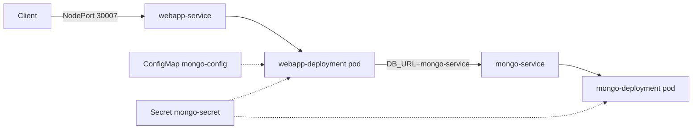

# Baseline Review — Senior Engineer Read of the Existing Manifests

Reviewing what's on `main` today, as if this were a PR. Nothing here is
urgent-fix-right-now; each finding is tagged with the lesson that will
address it so we fix things in the right order instead of piling on scope.

## Current architecture

- 1 replica each of `mongo` and `webapp`, no PersistentVolume, no probes, no
  resource requests/limits, `webapp-service` exposed via `NodePort`.

## Findings

### 1. Secret is committed to git in `mongo-secret.yaml` — **security**
`data.mongo-root-username` / `mongo-root-password` are base64, not encrypted.
Base64 is an *encoding*, not a security control — anyone with repo access can
decode it instantly (`echo bW9uZ29hZG1pbg== | base64 -d`). This is fine for a
throwaway local-learning secret, but it's the #1 mistake seen in real
production repos. **Addressed in lesson 7** (Sealed Secrets / SOPS / external
secret store). Until then: don't reuse this password anywhere real.

### 2. No liveness/readiness probes
Kubernetes has no way to know if the app is actually healthy or ready to take
traffic — it only knows the container process is running. If the app hangs
(e.g. lost DB connection) it keeps receiving traffic forever, and a bad
rollout won't be caught automatically. **Addressed in lesson 4.**

### 3. No `resources.requests`/`limits` on either container
Without requests, the scheduler can't bin-pack correctly and a single pod can
starve every other workload on the node (noisy neighbor). Without limits, a
memory leak in one pod can pressure/evict others. **Addressed in lesson 5.**

### 4. MongoDB has no PersistentVolumeClaim
`mongo-deployment` writes to the container's ephemeral filesystem. Pod
reschedule, node drain, or a simple `kubectl rollout restart` = **all data
gone**. This is the most consequential gap for a stateful workload.
**Addressed in lesson 6.**

### 5. `webapp-service` is `NodePort`
Works for local learning, but NodePort isn't how you expose HTTP services in
production (fixed high port, no host/path routing, no TLS termination, one
service per port). **Addressed in lesson 3 (Ingress)** — NodePort becomes
ClusterIP + Ingress.

### 6. Single replica, no PodDisruptionBudget, no rolling strategy tuning
One `webapp` pod means any restart/rollout/node drain = brief full outage.
**Touched in lesson 5/9 (scaling) and formalized in lesson 13** (deployment
strategies), where `maxUnavailable`/`maxSurge`/PDBs get set deliberately
instead of left at defaults.

### 7. Image is a public tutorial image, pinned to a tag (good) but not yours
`nanajanashia/k8s-demo-app:v1.0` — pinning to a real tag instead of `latest`
is correct practice, keep doing that for every image going forward. But it's
not your own NestJS source, which matters once we reach CI/CD (lesson 11):
you need something to actually build. Flagged in the roadmap; decide before
lesson 11.

### 8. No `namespace` set — everything runs in `default`
Not wrong for a single-app learning cluster, but production clusters isolate
workloads per namespace (env or per-team) for RBAC and quota boundaries.
Worth a deliberate decision in lesson 8 (RBAC & Security) rather than an
accident of omission.

### 9. Raw manifests, no templating/environment overlay
Right now `webapp.yaml`/`mongo.yaml` are hand-written and would have to be
copy-pasted and hand-edited for a second environment (staging vs prod).
**Addressed starting lesson 1 (Helm)** and reinforced in lesson 2 (Kustomize)
so you can compare both approaches directly.

## What's already good (keep doing this)

- Secrets/config are externalized from the Deployment spec via `secretKeyRef`
  / `configMapKeyRef` instead of hardcoded env values — correct pattern.
- Image tags are pinned (`mongo:8`, `...:v1.0`), not `latest`.
- Clear `app` label + matching `selector` on both Deployments/Services.
- Comments in the YAML explain *why*, not just *what* — good habit, keep it
  in new manifests too (but move deeper explanations to `docs/` so the YAML
  stays readable).

## Review questions

1. Which of the 9 findings above would you fix *first* if this were a real
   production incident review, and why — severity, or ease of fix?
2. Why is base64 encoding not a security boundary? What would make
   `mongo-secret.yaml` actually safe to commit to a public repo?
3. What's the practical failure mode you'd observe (via `kubectl`) if the
   node running `mongo-deployment`'s pod was drained right now?
4. Why does pinning `mongo:8` instead of `mongo:latest` matter for a
   production rollout, specifically around rollback?
