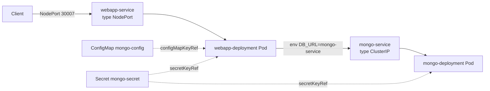

# Lesson 1 — Kubernetes Basics (Deployments, Services, ConfigMaps, Secrets)

Files live in `lessons/01-k8s-basics/` · Commands used:
[`docs/commands/01-k8s-basics-commands.md`](commands/01-k8s-basics-commands.md)

> This lesson documents what was already built (from a YouTube tutorial)
> before this repo's mentor-style workflow started — it was committed
> directly to `main` rather than a lesson branch, since it's the fixed
> starting point everything else builds on, not new in-progress work.

This lesson assumes zero prior Helm/Kustomize/production experience — just
"I can write a Deployment and a Service and get a pod running." That's
exactly where this project started, and it's a completely normal starting
point. The goal here is to look at that same setup through a **production**
lens: what's fine as-is, what's a ticking time bomb, and why.

## 1. The four building blocks in this lesson

### Pod (the thing you never create directly)

A **Pod** is the smallest deployable unit in Kubernetes — one or more
containers that share a network namespace (same `localhost`) and storage.
You'll notice none of the files in `lessons/01-k8s-basics/` actually say
`kind: Pod`. That's intentional and normal: in production you almost never
create bare Pods. You create a **Deployment**, and the Deployment creates and
manages Pods for you (via an intermediate object called a ReplicaSet).

### Deployment (`mongo.yaml`, `webapp.yaml`)

A Deployment describes the **desired state** of a set of identical Pods:
which container image, how many replicas, what env vars, etc. Kubernetes'
control loop constantly compares this desired state to what's actually
running and reconciles the difference — if a Pod dies, a new one is created
automatically to get back to the declared `replicas` count.

```yaml
spec:
  replicas: 1                # how many identical Pods you want running
  selector:
    matchLabels:
      app: webapp             # "which Pods belong to me" — must match template labels below
  template:                   # the Pod blueprint — everything below is what each Pod looks like
    metadata:
      labels:
        app: webapp
    spec:
      containers:
      - name: webapp
        image: nanajanashia/k8s-demo-app:v1.0
        ports:
        - containerPort: 3000
```

**Why `selector.matchLabels` and `template.metadata.labels` must match:**
the Deployment doesn't track "its" Pods by name or ID — it finds them purely
by label matching. If you changed `template.metadata.labels` without
updating `selector.matchLabels`, the Deployment would lose track of Pods it
already created and (depending on the mismatch) either orphan them or refuse
to reconcile. This label-matching pattern is used everywhere in Kubernetes
(Services use it too, see below), so it's worth internalizing now.

**Production considerations for Deployments:**
- `replicas: 1` (what both Deployments here use) means **zero redundancy** —
  any restart, crash, or node issue causes a full outage of that component
  until a replacement Pod is scheduled and starts. Fine for local learning,
  wrong for production. (Addressed properly in lesson 6 — resource limits —
  and lesson 14 — deployment strategies — once there's more than 1 replica
  to actually roll out safely.)
- There's no `resources.requests`/`resources.limits` here at all. Without
  requests, the scheduler is placing this Pod on a node with zero guarantee
  it'll actually fit; without limits, this container could consume all
  available CPU/memory on its node and starve every other Pod there ("noisy
  neighbor"). Lesson 6.
- There's no `livenessProbe`/`readinessProbe`. Kubernetes currently only
  knows "is the container process alive", not "is the app actually able to
  serve traffic". If the Node.js process hangs but doesn't crash, Kubernetes
  will happily keep sending it traffic forever. Lesson 5.
- Default rolling-update behavior (`strategy.type: RollingUpdate` is the
  implicit default when unset) means a `kubectl set image` or `helm upgrade`
  today would try to start a new Pod before killing the old one — but with
  `replicas: 1`, Kubernetes still has to briefly juggle capacity, and without
  a readiness probe it can't correctly tell when the new Pod is *actually*
  ready to take over. Lesson 5 + 14 close this gap together.

### Service (`mongo.yaml` bottom half, `webapp.yaml` bottom half)

Pods are ephemeral — they get new IPs every time they're recreated. A
**Service** gives a stable DNS name + virtual IP in front of a changing set
of Pods, so nothing else in the cluster needs to track individual Pod IPs.

```yaml
apiVersion: v1
kind: Service
metadata:
  name: mongo-service
spec:
  selector:
    app: mongo            # same label-matching pattern as Deployments
  ports:
    - port: 27017          # the Service's own port
      targetPort: 27017    # the port on the Pod to forward to
```

This project uses **two different Service types**, and the difference matters:

| Type | Used by | Reachable from | Typical production use |
|---|---|---|---|
| `ClusterIP` (the default — `mongo-service` doesn't even set `type:`, so it's `ClusterIP` implicitly) | MongoDB | Only inside the cluster | Internal-only components — databases, internal APIs. Never expose a database directly to the internet. |
| `NodePort` (`webapp-service`, `type: NodePort`, `nodePort: 30007`) | webapp | Any cluster node's IP, on port 30007 | Local dev/demos only, in practice. |

**Why `NodePort` is a local-only convenience, not a production pattern:**
- The port (30007 here) is a fixed number in the 30000–32767 range — you
  can't run two apps both wanting port 443 without renumbering, there's no
  path-based routing (`/api` vs `/admin`), and there's no TLS termination
  built in.
- In production you'd put a `ClusterIP` Service behind an **Ingress**
  (lesson 4) — one entry point that does host/path routing and TLS to
  multiple `ClusterIP` services, which is the pattern that actually scales
  to more than one app.

**MongoDB's DNS name is exactly the Service name.** Inside the cluster,
`mongo-service` (from `mongo-config.yaml`'s `mongo-url` value) resolves via
Kubernetes' built-in DNS to whichever Pod(s) currently match
`selector: {app: mongo}` — this is *why* the webapp's `DB_URL` env var can
just be the literal string `mongo-service` instead of a Pod IP that would
change on every restart.

### ConfigMap (`mongo-config.yaml`)

A ConfigMap holds **non-secret** configuration data as key-value pairs,
decoupled from the container image and from the Pod spec:

```yaml
apiVersion: v1
kind: ConfigMap
metadata:
  name: mongo-config
data:
  mongo-url: mongo-service
```

Consumed in `webapp.yaml` via `configMapKeyRef`:

```yaml
env:
- name: DB_URL
  valueFrom:
    configMapKeyRef:
      name: mongo-config
      key: mongo-url
```

**Why bother with a ConfigMap instead of hardcoding `DB_URL: mongo-service`
directly in the Deployment?** Separation of concerns: the same container
image can run against different config (e.g. a different DB hostname per
environment) without rebuilding the image or editing the Deployment spec —
only the ConfigMap changes.

**Production consideration:** changing a ConfigMap that's consumed as an
env var (as here) does **not** automatically restart the Pods to pick up the
new value — env vars are only read at container start. You'd need a rollout
restart (`kubectl rollout restart deployment/webapp-deployment`) after
editing the ConfigMap. (If instead you mount a ConfigMap as a *volume*, the
file content does update live without a restart — but env vars never do.
This surprises almost everyone the first time.)

### Secret (`mongo-secret.yaml`)

Structurally almost identical to a ConfigMap, but semantically meant for
sensitive data, and consumed via `secretKeyRef` instead of `configMapKeyRef`:

```yaml
apiVersion: v1
kind: Secret
metadata:
  name: mongo-secret
type: Opaque
data:
  mongo-root-username: bW9uZ29hZG1pbg==
  mongo-root-password: cGFzc3dvcmQxMjM=
```

`type: Opaque` just means "generic user-defined key-value secret" — there
are other built-in types (`kubernetes.io/tls`, `kubernetes.io/dockerconfigjson`,
etc.) for specific well-known shapes of secret data, not relevant here.

**The single most important thing to understand about this file:**
`data` values are **base64, not encrypted**. Anyone who can read this file
(or `kubectl get secret mongo-secret -o yaml`, if they have read access in
the cluster) can trivially reverse it:

```bash
echo 'bW9uZ29hZG1pbg==' | base64 -d
# -> mongoadmin
```

Base64 is an **encoding** (a way to represent binary-safe text), not a
security control. It exists here purely because the Kubernetes API requires
`Secret.data` values to be base64 strings — it is not doing anything to
protect the content. A `Secret` object at rest in etcd is only as protected
as your cluster's etcd encryption-at-rest configuration (off by default on
plain Minikube) and Kubernetes RBAC (who's allowed to `get`/`list` secrets).
**Committing a real production secret this way to git is a genuine, common
incident-causing mistake** — treat this file's values as "already
compromised" and never reuse them anywhere real. Lesson 8 replaces this
with proper secret management (Sealed Secrets or an external secret store),
so the actual secret value never lives in git in any recoverable form.

Consumed identically to the ConfigMap pattern, just with `secretKeyRef`:

```yaml
env:
- name: USER_NAME
  valueFrom:
    secretKeyRef:
      name: mongo-secret
      key: mongo-root-username
```

## 2. How it all fits together



Both the webapp Pod and the mongo Pod read the **same** `mongo-secret` — the
webapp needs the credentials to *connect* to Mongo, and Mongo's own
container needs them to *set up* that root user on first start
(`MONGO_INITDB_ROOT_USERNAME`/`PASSWORD` are Mongo's official Docker image
env vars for bootstrapping auth). One Secret, two different consumers, two
different env var names — this is a completely normal pattern.

## 3. What's already good here (keep doing this)

- Config and secrets are externalized via `configMapKeyRef`/`secretKeyRef`
  instead of hardcoded literal values in the Deployment — correct pattern,
  used correctly.
- Image tags are pinned (`mongo:8`, `nanajanashia/k8s-demo-app:v1.0`), never
  `latest`. This matters a lot for production rollback: if `latest` silently
  points to a different image tomorrow, `helm rollback`/`kubectl rollout
  undo` to "the same tag as before" no longer means "the same image as
  before" — pinning is what makes rollback actually deterministic.
- Consistent `app` label used identically as both the Deployment's
  `selector.matchLabels`/`template.metadata.labels` and the matching
  Service's `selector` — no mismatches, no typos.

## 4. Production readiness gaps (full list, for reference)

Beyond what's called out per-topic above, in severity-ish order:

1. **Secret committed to git in reversible form** — see Secret section above. → lesson 8.
2. **No liveness/readiness probes** — Kubernetes can't tell a hung app from a healthy one. → lesson 5.
3. **No resource requests/limits** — no scheduling guarantees, no noisy-neighbor protection. → lesson 6.
4. **MongoDB has no PersistentVolumeClaim** — it writes to the container's ephemeral filesystem. A Pod reschedule, node drain, or even `kubectl rollout restart` = **all data gone**. This is the most consequential gap for a stateful workload. → lesson 7.
5. **`webapp-service` is `NodePort`** — no TLS, no host/path routing, fixed high port. → lesson 4 (Ingress).
6. **Single replica, no PodDisruptionBudget** — any restart/rollout/node drain of the sole Pod is a brief full outage. → lessons 6/10 (scaling), formalized in lesson 14 (deployment strategies).
7. **No `namespace` set — everything runs in `default`** — fine for one learning app, but production clusters isolate workloads per namespace for RBAC/quota boundaries. → lesson 9 (RBAC & Security).
8. **Raw manifests, no templating/environment overlay** — copy-paste required for a second environment. → lesson 2 (Helm, already done) and lesson 3 (Kustomize) for comparison.
9. **Public tutorial image, not your own NestJS source** — fine through most of this course, becomes a real decision point at lesson 12 (CI/CD), since there'd be nothing of yours to actually build.

None of these are "wrong" for a learning project — they're exactly the kind
of thing a senior engineer flags in a first-pass review, each with a
concrete plan for *when* it gets addressed instead of "fix everything now."

## 5. Verification

Full commands with expected output:
[`docs/commands/01-k8s-basics-commands.md`](commands/01-k8s-basics-commands.md).
In short: `kubectl apply -f lessons/01-k8s-basics/`, then confirm both Pods
reach `Running`/`1/1`, then reach the webapp over its NodePort.

## 6. Debugging exercise

1. Break the link between the webapp and its config on purpose:
   ```bash
   kubectl set env deployment/webapp-deployment DB_URL=wrong-service-name
   ```
   (This directly overrides the env var, bypassing the ConfigMap — a decent
   stand-in for "someone fat-fingered the ConfigMap value.")
2. Watch what happens to the Pod:
   ```bash
   kubectl get pods
   kubectl logs deployment/webapp-deployment
   ```
   Notice the Pod likely still shows `Running` (the Node process itself
   didn't crash) even though it can no longer reach Mongo — this is *exactly*
   the "no readiness probe" gap from section 4 made concrete: Kubernetes has
   no way to know this Pod is actually broken.
3. Confirm the app is broken from the outside too (any endpoint touching
   Mongo should fail/hang) using `curl` against the NodePort.
4. Fix it properly — don't just re-run `kubectl set env` with the right
   value, put the ConfigMap back in charge:
   ```bash
   kubectl edit deployment/webapp-deployment
   # replace the hardcoded DB_URL value with the original configMapKeyRef block
   ```
   or simplest: re-apply the original file,
   `kubectl apply -f lessons/01-k8s-basics/webapp.yaml`, which resets the env
   block to exactly what's declared there.
5. Confirm recovery with `kubectl get pods` and another `curl`.

**What this teaches:** "the Pod is Running" and "the application is healthy"
are two completely different facts, and right now Kubernetes only tracks the
first one. Keep this exercise in mind when you get to lesson 5 (health
probes) — you'll redo a version of this same failure and see the difference
a `readinessProbe` makes.

## 7. Review questions

1. Why must `selector.matchLabels` on a Deployment match
   `template.metadata.labels` exactly? What actually goes wrong if they drift?
2. Why is `mongo-service` `ClusterIP` while `webapp-service` is `NodePort` —
   what's the underlying reasoning, not just "that's what the tutorial did"?
3. You changed `mongo-config.yaml`'s `mongo-url` value and ran
   `kubectl apply -f lessons/01-k8s-basics/mongo-config.yaml`. Does the
   running webapp Pod see the new value immediately? Why or why not?
4. What specifically makes `mongo-secret.yaml`'s values *not* secure, and
   what would need to be true for a Secret manifest to actually be safe to
   commit to a public repo?
5. If the node running `mongo-deployment`'s Pod were drained right now, what
   would you expect to observe via `kubectl get pods`, and what would you
   lose?
